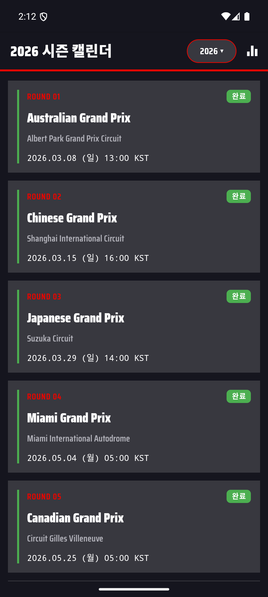
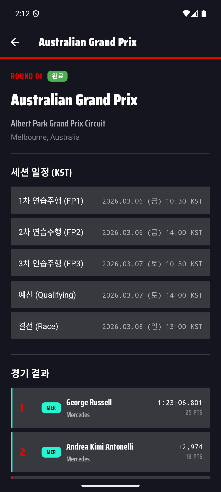
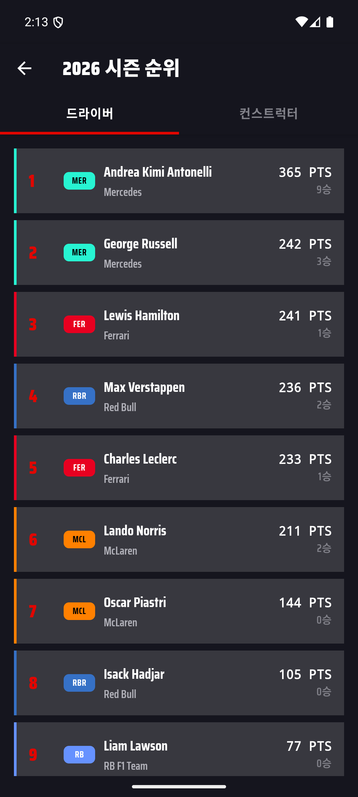
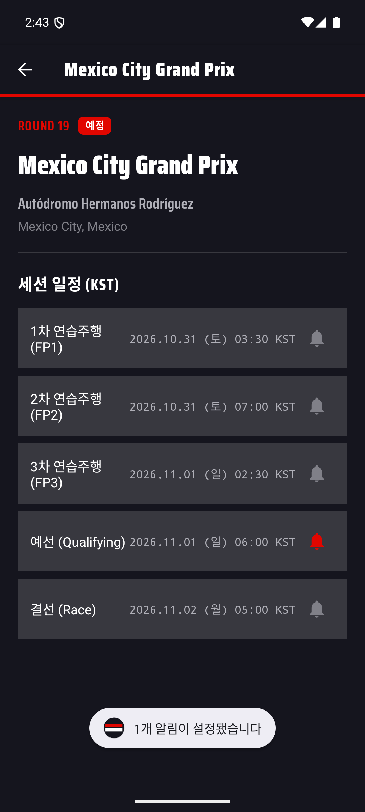

# 🏁 Boxbox

F1 2026 시즌을 추적하는 안드로이드 앱입니다. 캘린더, 레이스 결과, 드라이버/컨스트럭터 순위를 한 곳에서 확인하고, 원하는 세션 전에 알림을 받을 수 있습니다.

Kotlin + 전통적인 XML View 방식(Jetpack Compose 미사용)으로 만들었고, [Jolpica F1 API](https://jolpi.ca/)(Ergast 호환 공개 API)를 데이터 소스로 사용합니다.

**[⬇️ APK 다운로드 (v1.0)](https://github.com/syc030403/boxbox/releases/latest)**

<p align="center">
  
  
  
  
</p>

## 주요 기능

- **시즌 캘린더**: 라운드별 그랑프리 목록, 날짜/시간을 KST로 자동 변환, 완료/예정 상태 표시
- **레이스 상세**: 서킷·위치 정보, 세션별(FP1~3/예선/스프린트/결선) 일정
- **경기 결과**: 완료된 레이스의 순위·기록·포인트 (팀 컬러 칩으로 구분)
- **드라이버/컨스트럭터 순위**: 탭으로 전환, 포인트·우승 횟수 표시
- **시즌 전환**: 2024~2026 시즌 데이터를 즉시 전환해서 조회
- **세션별 알림**: 각 세션(연습주행/예선/스프린트/결선)마다 원하는 시점(1일/3시간/1시간/30분/10분 전)에 로컬 알림 설정
- **오프라인 지원**: 마지막으로 받아온 데이터를 기기에 캐싱해서 인터넷이 끊겨도 조회 가능. 당겨서 새로고침하면 강제로 최신 데이터를 다시 받음
- **F1 브랜드 톤 디자인**: Saira Condensed 폰트, 팀 컬러 액센트, 다크 테마

## 기술 스택

| 영역 | 사용 기술 |
|---|---|
| 언어 | Kotlin |
| UI | XML View + ViewBinding (Jetpack Compose 미사용) |
| 네트워킹 | Retrofit2 + Gson + OkHttp |
| 비동기 | Kotlin Coroutines |
| 데이터 소스 | [Jolpica F1 API](https://jolpi.ca/) (Ergast 호환, 무료 공개 API) |
| 로컬 캐시 | 파일 기반 JSON 캐시 (TTL 적용) |
| 알림 | AlarmManager(정확한 알람) + NotificationCompat |
| 디자인 시스템 | Material Components for Android |

## 아키텍처 메모

- 전형적인 Activity + ViewBinding 구조이며, 별도 상태관리 라이브러리는 쓰지 않았습니다.
- `CachedApi`가 네트워크 호출을 감싸서, 캐시가 신선하면 네트워크를 타지 않고 캐시를 즉시 반환하고, 오래됐거나 없으면 온라인일 때만 새로 받아옵니다. 오프라인이면 오래된 캐시라도 반환합니다.
- 레이스 세션 알림은 `AlarmManager.setExactAndAllowWhileIdle`로 예약하고, 재부팅 시 `BootReceiver`가 저장된 알림 목록을 다시 예약합니다.
- 팀 컬러/약어는 `TeamInfo`에서 constructorId 기준으로 매핑합니다 (공식 로고 이미지 대신 컬러+이니셜 칩 사용 — 상표권 이슈 회피).

## 빌드하기

```bash
git clone https://github.com/syc030403/boxbox.git
cd boxbox
./gradlew assembleDebug
```

- JDK 17 이상, Android SDK (compileSdk 35) 필요
- `local.properties`에 `sdk.dir` 설정 (Android Studio로 열면 자동 생성됨)

## 데이터 출처 및 고지

- 레이스/결과/순위 데이터: [Jolpica F1 API](https://jolpi.ca/) (Ergast 호환)
- 본 앱은 비공식 팬 프로젝트이며 Formula 1, FIA와 어떠한 제휴 관계도 없습니다.
